# MANUAL BOOK DAPURIA

**Asisten Rekomendasi Resep Berdasarkan Bahan yang Dimiliki**

| Keterangan | Isi |
| --- | --- |
| Versi program | 1.0.1, mengikuti implementasi UI saat panduan disusun |
| Tanggal penyusunan | 27 Oktober 2026 |
| Lingkungan panduan instalasi | Windows, PowerShell, dan Python 3.12 |
| Bagian 1 | Instalasi, konfigurasi, pengoperasian, dan pemeliharaan untuk developer |
| Bagian 2 | Penggunaan aplikasi untuk pengguna |

Dapuria mencari resep dari bahan yang disebutkan pengguna. Program menggunakan corpus 5.000 resep, pencarian semantik, pencocokan bahan, dan pemeringkatan. Hasil akhir menampilkan maksimal lima resep yang memenuhi aturan sistem.

**Ketentuan gambar dalam panduan:**

- **Tersedia:** gambar sudah ada di `artifacts/ui/` dan ditampilkan melalui tautan relatif dalam dokumen ini.
- **Perlu screenshot manual:** nama file yang disarankan dicantumkan, disertai objek yang perlu difoto. File tersebut belum tersedia.
- Screenshot hasil di folder artifacts menggunakan contoh data untuk dokumentasi UI. Gunakan sebagai ilustrasi tampilan; nama dan urutan resep pada penggunaan sebenarnya dapat berbeda. Pengujian rekomendasi menggunakan aplikasi utama, bukan server preview.
- Untuk dipindahkan ke Word, masukkan file gambar yang disebutkan, lalu gunakan judul gambar di bawahnya sebagai caption. Gambar dalam `artifacts/ui/archive/` adalah versi lama dan tidak digunakan dalam panduan ini.

## Daftar Isi

**Bagian 1 — Panduan Developer**

1.1 Kebutuhan perangkat dan perangkat lunak  
1.2 Struktur project  
1.3 Instalasi Python dan penyiapan project  
1.4 Pembuatan environment dan instalasi dependensi  
1.5 Pemeriksaan data dan konfigurasi  
1.6 Pemasangan Ollama dan Llama 3, opsional  
1.7 Menjalankan dan menghentikan aplikasi  
1.8 Pengujian instalasi  
1.9 Alur kerja sistem  
1.10 Perubahan kode dan aset  
1.11 Pemeliharaan dan pembangunan ulang indeks  
1.12 Pencadangan dan pemulihan data  
1.13 Pemecahan masalah developer  
1.14 Dokumentasi screenshot

**Bagian 2 — Panduan Pengguna**

2.1 Persiapan dan pengenalan tampilan  
2.2 Memulai pencarian resep  
2.3 Menunggu pemrosesan  
2.4 Menjawab pertanyaan bahan pelengkap  
2.5 Membaca hasil rekomendasi  
2.6 Membuka detail dan membaca langkah memasak  
2.7 Melanjutkan percakapan atau mencari resep baru  
2.8 Memperbarui bahan dalam percakapan  
2.9 Mengatur bahan yang dihindari  
2.10 Mengelola riwayat percakapan  
2.11 Melihat hasil pencarian sebelumnya  
2.12 Menangani kendala penggunaan  
2.13 Contoh alur penggunaan  
2.14 Batas kemampuan aplikasi  
2.15 Daftar gambar dan kebutuhan screenshot tambahan

---

# BAGIAN 1 — PANDUAN DEVELOPER

## 1.1 Kebutuhan Perangkat dan Perangkat Lunak

| Komponen | Kebutuhan |
| --- | --- |
| Sistem operasi panduan | Windows 64-bit; jika memakai Ollama, ikuti persyaratan Windows pada dokumentasi Ollama |
| Python | Gunakan Python 3.12; README project juga menyarankan Python 3.11 |
| Terminal | PowerShell atau terminal PowerShell di Visual Studio Code |
| Editor | Visual Studio Code atau editor lain yang mendukung Python |
| Browser | Browser modern, misalnya Microsoft Edge atau Google Chrome |
| Internet | Dibutuhkan untuk instalasi dependensi dan pengunduhan model yang belum tersedia di komputer |
| Data resep | Corpus dan indeks ChromaDB yang disertakan bersama project |
| Ollama dan Llama 3 | Opsional, untuk penyusunan kalimat klarifikasi dan ringkasan hasil |

Project belum menetapkan batas minimum RAM dan ruang penyimpanan berdasarkan pengujian perangkat. Sediakan ruang untuk environment Python, cache model SBERT, serta model Llama 3 jika digunakan. Kebutuhan memori bertambah saat model lokal dijalankan.

GPU bukan syarat pada konfigurasi aplikasi; pemrosesan dapat menggunakan CPU. Kecepatan bergantung pada perangkat dan model yang dijalankan.

## 1.2 Struktur Project

```text
skripsi_final/
├── app.py
├── requirements.txt
├── pyproject.toml
├── .env.example
├── .streamlit/
│   └── config.toml
├── src/dapuria/
│   ├── config.py
│   ├── preprocessing.py
│   ├── pantry.py
│   ├── preferences.py
│   ├── main_ingredients.py
│   ├── retrieval.py
│   ├── reranking.py
│   ├── validation.py
│   ├── recipe_service.py
│   ├── recipe_details.py
│   ├── llama_service.py
│   ├── chat_history.py
│   ├── ui.py
│   └── assets/
├── data/
│   ├── corpus/
│   ├── chroma_db/
│   ├── evaluation_source/
│   └── local_history/          # Dibuat saat penyimpanan riwayat digunakan
├── scripts/
├── tests/
├── evaluation/
├── artifacts/ui/
├── docs/
└── build/lib/                 # Salinan hasil build jika tersedia
```

| Lokasi | Fungsi |
| --- | --- |
| `app.py` | Menjalankan antarmuka Streamlit dan mengatur alur percakapan |
| `src/dapuria/` | Sumber kode utama yang digunakan aplikasi |
| `src/dapuria/assets/style.css` | Warna, tata letak, bubble chat, dan animasi |
| `src/dapuria/assets/image/` | Logo dan ilustrasi aplikasi |
| `data/corpus/` | Data resep untuk indeks dan pemulihan langkah memasak |
| `data/chroma_db/` | Indeks vektor resep yang digunakan saat pencarian |
| `data/local_history/` | Riwayat lokal percakapan, terpisah dari indeks resep |
| `scripts/` | Pemeriksaan layanan dan pembangunan ulang indeks |
| `tests/` | Pengujian otomatis |
| `evaluation/` | Workflow evaluasi penelitian |
| `artifacts/ui/` | Screenshot dan alat pengambilan gambar UI |

**Lakukan pengembangan pada `src/dapuria`, bukan pada `build/lib`.** Folder `build/lib` berisi hasil build dan dapat ditimpa saat paket dibangun kembali. Menjalankan `app.py` memakai sumber di `src`.

**Gambar 1.1 — Struktur folder project.**  
Status: **Perlu screenshot manual.**  
Nama file yang disarankan: `artifacts/ui/manual/developer-project-structure.png`.  
Ambil tampilan Explorer VS Code yang memperlihatkan `app.py`, `requirements.txt`, `src/dapuria`, dan `data`.

## 1.3 Instalasi Python dan Penyiapan Project

1. Unduh installer Python 3.12 untuk Windows 64-bit dari [situs resmi Python](https://www.python.org/downloads/windows/).
2. Jalankan installer. Jika menggunakan installer klasik, aktifkan **Add python.exe to PATH**, lalu selesaikan instalasi. Rujukan: [panduan instalasi Python untuk Windows](https://docs.python.org/3.12/using/windows.html).
3. Tutup dan buka kembali terminal setelah instalasi.
4. Periksa versi Python:

```powershell
py -3.12 --version
```

5. Salin atau ekstrak folder project ke komputer. Pastikan folder `data`, termasuk corpus dan indeks ChromaDB, ikut disalin.
6. Buka folder project di VS Code atau PowerShell. Contoh berikut harus diganti sesuai lokasi project:

```powershell
cd "C:\lokasi\skripsi_final"
Get-ChildItem
```

Hasil pemeriksaan harus memperlihatkan `app.py`, `requirements.txt`, `pyproject.toml`, `src`, dan `data`.

**Gambar 1.2 — Instalasi Python.**  
Status: **Perlu screenshot manual.**  
Nama file yang disarankan: `artifacts/ui/manual/developer-python-installation.png`.  
Ambil halaman installer yang menampilkan versi Python dan pilihan penambahan PATH, atau hasil terminal `py -3.12 --version` jika proses instalasi sudah selesai.

## 1.4 Pembuatan Environment dan Instalasi Dependensi

Jalankan seluruh perintah berikut dari root project, yaitu folder yang berisi `app.py`.

### 1.4.1 Membuat virtual environment

```powershell
py -3.12 -m venv .venv
```

Jika perintah `py` tidak tersedia tetapi `python --version` sudah menunjuk Python 3.12, gunakan:

```powershell
python -m venv .venv
```

### 1.4.2 Menginstal dependensi dan project

```powershell
.\.venv\Scripts\python.exe -m pip install --upgrade pip
.\.venv\Scripts\python.exe -m pip install -r requirements.txt
.\.venv\Scripts\python.exe -m pip install -e .
```

Perintah pertama memperbarui pip. Perintah kedua memasang dependensi aplikasi. Perintah ketiga memasang project dalam mode editable sehingga sumber di `src` dapat digunakan oleh script dan pengujian.

Dependensi utama mencakup Streamlit, ChromaDB, Sentence Transformers, NumPy, Pandas, Requests, PyArrow, dan Pytest. Batas versi tercantum dalam `requirements.txt`.

### 1.4.3 Memeriksa instalasi

```powershell
.\.venv\Scripts\python.exe --version
.\.venv\Scripts\python.exe -m pip check
.\.venv\Scripts\python.exe -c "from dapuria import Settings; print(Settings().model_name)"
```

Pemeriksaan terakhir seharusnya menampilkan:

```text
LazarusNLP/all-indo-e5-small-v4
```

Panduan ini menggunakan path Python dalam `.venv`, sehingga aktivasi environment tidak wajib. Jika ingin mengaktifkannya, jalankan:

```powershell
.\.venv\Scripts\Activate.ps1
```

Jika PowerShell menolak aktivasi script, lanjutkan menggunakan path `.\.venv\Scripts\python.exe` seperti contoh sebelumnya.

**Gambar 1.3 — Environment dan dependensi berhasil dipasang.**  
Status: **Perlu screenshot manual.**  
Nama file yang disarankan: `artifacts/ui/manual/developer-dependencies-ready.png`.  
Ambil terminal yang menunjukkan versi Python, hasil `pip check`, dan nama model dari perintah pemeriksaan.

## 1.5 Pemeriksaan Data dan Konfigurasi

### 1.5.1 Memastikan data tersedia

```powershell
Test-Path -LiteralPath "data/corpus/resep_5000_clean_SAFE.csv"
Test-Path -LiteralPath "data/chroma_db/chroma.sqlite3"
```

Keduanya seharusnya menghasilkan `True`. Pemeriksaan ini memastikan file ada; kesehatan koleksi diperiksa melalui smoke test pada bagian 1.8.

| Data | Penggunaan |
| --- | --- |
| `data/corpus/resep_5000_clean_SAFE.csv` | Corpus utama 5.000 resep |
| `data/corpus/resep_5000_clean.parquet` | Bentuk Parquet corpus yang disertakan |
| `data/chroma_db/` | Seluruh folder indeks, termasuk SQLite dan file indeks pendamping |
| `data/evaluation_source/yummy_recipes_1300.csv` | Sumber penyusunan kueri evaluasi; bukan indeks pencarian utama |

Jangan hanya menyalin `chroma.sqlite3`; sertakan seluruh folder `chroma_db`. Instalasi baru dapat memakai indeks bawaan tanpa melakukan rebuild.

### 1.5.2 Parameter utama

Konfigurasi dibaca dari `src/dapuria/config.py` dan environment variable.

| Environment variable | Nilai bawaan | Fungsi |
| --- | --- | --- |
| `DAPURIA_MODEL_NAME` | `LazarusNLP/all-indo-e5-small-v4` | Model embedding |
| `DAPURIA_CHROMA_DIR` | `data/chroma_db` di root project | Lokasi indeks |
| `DAPURIA_COLLECTION_NAME` | `resep_masakan` | Nama koleksi ChromaDB |
| `DAPURIA_CORPUS_PATH` | `data/corpus/resep_5000_clean_SAFE.csv` di root project | Sumber detail resep |
| `DAPURIA_TOP_K_SBERT` | `50` | Jumlah kandidat semantik |
| `DAPURIA_MAX_KEYWORD_EXTRA` | `20` | Batas kandidat lexical tambahan |
| `DAPURIA_SEMANTIC_WEIGHT` | `0.9` | Bobot skor semantik |
| `DAPURIA_INGREDIENT_WEIGHT` | `0.1` | Bobot efisiensi bahan |
| `DAPURIA_TOP_N` | `5` | Batas jumlah rekomendasi |
| `DAPURIA_SELECTION_POLICY` | `pantry` pada aplikasi; `wlc` pada script jika override tidak diatur | Memilih urutan praktis dan variasi menu, atau urutan skor WLC |
| `DAPURIA_MIN_INGREDIENT_COUNT` | `1` | Minimum bahan unik pada validasi awal |
| `DAPURIA_HISTORY_PATH` | `data/local_history/chats.sqlite3` di root project | Lokasi database percakapan, dibaca oleh `app.py` |
| `DAPURIA_OLLAMA_URL` | `http://localhost:11434` | Alamat layanan Ollama |
| `DAPURIA_OLLAMA_MODEL` | `llama3` | Model untuk klarifikasi dan ringkasan |
| `DAPURIA_OLLAMA_TIMEOUT` | `60` | Batas waktu permintaan narasi, dalam detik |

File `.env.example` adalah contoh konfigurasi. Kode project **belum memuat file `.env` secara otomatis**. Menyalin `.env.example` menjadi `.env` saja belum menerapkan nilainya.

Untuk mengganti konfigurasi, set environment variable pada terminal yang dipakai menjalankan aplikasi. Contoh:

```powershell
$env:DAPURIA_OLLAMA_MODEL = "llama3"
$env:DAPURIA_HISTORY_PATH = Join-Path (Get-Location) "data/local_history/chats.sqlite3"
.\.venv\Scripts\python.exe -m streamlit run app.py
```

Nilai tersebut berlaku pada sesi terminal itu. Jika terminal baru dibuka, atur kembali nilai yang diperlukan. Setelah konfigurasi diubah, hentikan dan jalankan ulang aplikasi agar objek layanan dan cache memakai pengaturan baru.

Pertahankan konfigurasi bawaan untuk implementasi skripsi. Jumlah bobot semantik dan bahan harus `1.0`. Jika model embedding diganti, indeks juga harus dibangun menggunakan model yang sesuai.

## 1.6 Pemasangan Ollama dan Llama 3 — Opsional

Aplikasi tetap dapat mencari dan menampilkan resep tanpa Ollama. Dalam keadaan tersebut, pertanyaan pelengkap dan ringkasan menggunakan kalimat bawaan yang ditentukan sistem.

Untuk mengaktifkan Llama 3:

1. Pasang Ollama dari [halaman unduhan resmi](https://ollama.com/download/windows).
2. Buka terminal baru dan periksa instalasi:

```powershell
ollama --version
```

3. Unduh model yang sesuai dengan konfigurasi aplikasi:

```powershell
ollama pull llama3
ollama list
```

4. Pastikan `llama3` atau `llama3:latest` tercantum pada daftar model.
5. Ollama pada Windows biasanya berjalan di latar belakang setelah instalasi. Jika layanan belum berjalan, buka terminal terpisah dan jalankan:

```powershell
ollama serve
```

6. Periksa layanan lokal:

```powershell
Invoke-RestMethod -Uri "http://localhost:11434/api/tags"
```

Jika port `11434` sudah digunakan oleh Ollama yang aktif, tidak perlu menjalankan server kedua. Rujukan pemasangan, persyaratan sistem, dan alamat API: [dokumentasi Ollama untuk Windows](https://docs.ollama.com/windows).

Model Llama 3 menyusun kalimat dari hasil yang sudah dipilih sistem. Model tersebut tidak menentukan skor, urutan resep, maupun bahan atau langkah baru.

**Gambar 1.4 — Ollama dan model Llama 3 tersedia.**  
Status: **Perlu screenshot manual; hanya diperlukan jika Ollama digunakan.**  
Nama file yang disarankan: `artifacts/ui/manual/developer-ollama-ready.png`.  
Ambil hasil terminal `ollama list` yang menampilkan model `llama3`.

## 1.7 Menjalankan dan Menghentikan Aplikasi

### 1.7.1 Menjalankan aplikasi utama

```powershell
.\.venv\Scripts\python.exe -m streamlit run app.py
```

Buka alamat **Local URL** yang muncul di terminal, biasanya `http://localhost:8501`. Jika memakai port berbeda, gunakan alamat yang ditampilkan terminal.

Halaman awal dan riwayat dapat dibuka tanpa memuat SBERT. Saat pencarian pertama dikirim, program memuat model. Jika belum ada di cache, model akan diunduh sehingga proses pertama dapat lebih lama.

Jika port bawaan digunakan aplikasi lain, jalankan pada port lain:

```powershell
.\.venv\Scripts\python.exe -m streamlit run app.py --server.port 8502
```

### 1.7.2 Menghentikan dan menjalankan ulang

1. Pada terminal server Streamlit, tekan **Ctrl+C**.
2. Tunggu sampai server berhenti.
3. Jalankan kembali perintah pada bagian 1.7.1 jika diperlukan.
4. Refresh tab browser.

Project menggunakan `fileWatcherType = "none"` dalam `.streamlit/config.toml`. Setelah perubahan kode Python, konfigurasi, atau tema, jalankan ulang server untuk memastikan perubahan dimuat.

**Gambar 1.5 — Server Streamlit berjalan.**  
Status: **Perlu screenshot manual.**  
Nama file yang disarankan: `artifacts/ui/manual/developer-streamlit-running.png`.  
Ambil terminal yang memperlihatkan perintah menjalankan aplikasi dan Local URL. Tampilan aplikasi setelah server berjalan ditunjukkan pada Gambar 2.1.

## 1.8 Pengujian Instalasi

### 1.8.1 Pengujian otomatis

```powershell
.\.venv\Scripts\python.exe -m pytest -q
```

Pengujian mencakup parser, pencocokan bahan, pembatasan bahan, perhitungan skor, validasi, riwayat, dan alur UI. Model atau retriever diganti dengan data uji pada pengujian yang memerlukannya; kelulusan tes ini belum membuktikan model dan indeks produksi dapat digunakan.

Jumlah tes dapat berubah ketika fitur dikembangkan. Periksa apakah ada pengujian yang gagal, bukan hanya jumlah tes yang dijalankan.

### 1.8.2 Smoke test model dan indeks sebenarnya

```powershell
.\.venv\Scripts\python.exe scripts/smoke_test.py
```

Periksa keluaran berikut:

- Bagian `HEALTHCHECK` memuat model, nama koleksi, jumlah dokumen, lokasi indeks, dan konfigurasi pencarian.
- Indeks bawaan seharusnya memuat 5.000 dokumen jika data belum diganti.
- Kueri bahan utama dapat menghasilkan rekomendasi; kueri bumbu saja dapat ditolak oleh validasi bahan utama.
- Tidak muncul traceback yang menghentikan proses.

Smoke test membutuhkan model dan indeks sebenarnya. Pengunduhan model memerlukan internet jika model belum tersedia di cache.

### 1.8.3 Pemeriksaan melalui browser

1. Buka aplikasi utama.
2. Kirim `aku punya nasi sama telur`.
3. Jawab pertanyaan pelengkap jika muncul.
4. Pastikan hasil resep dan daftar langkah dapat dibaca.
5. Buka detail salah satu alternatif.
6. Periksa **Lanjutkan percakapan** dan **Cari resep baru** di bawah hasil.
7. Periksa rename, pin, dan hapus menggunakan percakapan uji.
8. Refresh browser dan pastikan percakapan yang disimpan dapat dibuka kembali.

**Gambar 1.6 — Pemeriksaan layanan dan indeks.**  
Status: **Perlu screenshot manual.**  
Nama file yang disarankan: `artifacts/ui/manual/developer-smoke-test.png`.  
Ambil hasil `smoke_test.py` yang memperlihatkan `HEALTHCHECK` dan satu hasil kueri. Gambar ini perlu diambil dari model/indeks sebenarnya, bukan server preview screenshot.

## 1.9 Alur Kerja Sistem

| Tahap | Proses utama | Modul |
| --- | --- | --- |
| 1 | Memisahkan nama bahan, menghapus jumlah/satuan dari nama, menormalisasi alias, dan menghapus duplikat | `preprocessing.py` |
| 2 | Memperbarui konteks bahan dan batasan percakapan | `pantry.py`, `preferences.py`, `app.py` |
| 3 | Memeriksa jumlah bahan dan keberadaan bahan utama | `validation.py`, `main_ingredients.py` |
| 4 | Mengambil kandidat semantik dan lexical dari indeks | `retrieval.py` |
| 5 | Menghitung coverage, efisiensi bahan, dan skor akhir | `reranking.py` |
| 6 | Menyisihkan kandidat yang melanggar batasan atau relevansi, lalu mengambil maksimal lima resep | `recipe_service.py` |
| 7 | Menanyakan satu bahan pelengkap jika diperlukan dan memproses jawabannya | `recipe_service.py`, `llama_service.py`, `app.py` |
| 8 | Menampilkan hasil dan menyimpan riwayat lokal | `ui.py`, `chat_history.py` |

Konfigurasi metode bawaan:

```text
Kandidat semantik        : Top-50
Kandidat lexical ekstra : Maksimal 20 yang belum ada dalam hasil semantik
Skor akhir              : 0,9 × skor semantik ternormalisasi
                          + 0,1 × efisiensi bahan
Hasil akhir             : Maksimal 5 resep setelah penyaringan
```

Skor semantik dinormalisasi menggunakan min-max pada kumpulan kandidat kueri. Efisiensi bahan memakai harmonic mean antara coverage resep dan coverage bahan pengguna.

Pembaruan 29 Oktober 2026: UI menggunakan kebijakan `pantry` untuk pemilihan akhir. Kandidat yang memenuhi relevansi dan batasan harus memakai setidaknya satu bahan utama pengguna, lalu diprioritaskan berdasarkan jumlah bahan tambahan paling sedikit, coverage pengguna, dan skor WLC. Resep dari keluarga judul yang sama tidak memenuhi semua slot alternatif. Mode `wlc` tetap tersedia melalui `DAPURIA_SELECTION_POLICY=wlc` dan menjadi default script evaluasi. Catat mode ini saat melakukan pengujian; urutan UI tidak selalu sama dengan urutan skor WLC.

Validasi awal memerlukan minimal satu bahan unik dan satu bahan utama yang dikenali. Syarat relevansi kandidat adalah minimal `min(2, jumlah bahan unik pengguna)` bahan pengguna yang cocok.

Bobot, batas kandidat, dan aturan penelitian dijelaskan lebih lanjut dalam [CONFIG_DECISIONS.md](CONFIG_DECISIONS.md). Workflow evaluasi tersedia dalam [evaluation/README.md](../evaluation/README.md); jalankan evaluasi baru pada direktori run baru agar hasil lama tetap tersimpan.

## 1.10 Perubahan Kode dan Aset

| Kebutuhan perubahan | Lokasi |
| --- | --- |
| Alur percakapan, state, tombol lanjut, dan sidebar | `app.py` |
| Komponen tampilan, kartu resep, dan daftar langkah | `src/dapuria/ui.py` |
| Warna, ukuran, jarak, serta animasi | `src/dapuria/assets/style.css` |
| Logo dan ilustrasi | `src/dapuria/assets/image/` |
| Alias dan pemrosesan masukan | `src/dapuria/preprocessing.py` |
| Pengelolaan bahan per percakapan | `src/dapuria/pantry.py` |
| Filter bahan yang dihindari | `src/dapuria/preferences.py` |
| Pengaturan model, parameter, dan path data | `src/dapuria/config.py` |

Tema utama menggunakan krem–terracotta. `logo_utama.png` digunakan untuk identitas aplikasi; `magnifying_glass_icon.png` menjadi ilustrasi halaman awal pada layar lebar.

Kode tampilan **Detail penelitian** berada dalam komentar pada `render_recipe()` di `src/dapuria/ui.py`. Jika perlu ditampilkan kembali untuk pemeriksaan internal, aktifkan blok tersebut dan restart aplikasi. Pada versi panduan ini, panel tersebut tidak tampil untuk pengguna.

Fitur unduh chat, simpan resep, editor koreksi bahan, dan panel alasan rekomendasi tidak tersedia pada UI saat ini.

## 1.11 Pemeliharaan dan Pembangunan Ulang Indeks

Rebuild diperlukan ketika indeks tidak tersedia, corpus berubah, atau model embedding diganti. Rebuild tidak diperlukan setiap kali aplikasi dijalankan.

1. Hentikan aplikasi dan proses lain yang memakai indeks.
2. Cadangkan folder indeks aktif sesuai bagian 1.12.
3. Untuk membuat indeks pada folder baru, jalankan:

```powershell
.\.venv\Scripts\python.exe scripts/rebuild_index.py --chroma-dir data/chroma_db_rebuilt
```

4. Periksa hasil pembangunan. Dengan corpus bawaan, akhir proses seharusnya menunjukkan jumlah koleksi 5.000.
5. Uji indeks baru menggunakan konfigurasi pada terminal yang sama:

```powershell
$env:DAPURIA_CHROMA_DIR = Join-Path (Get-Location) "data/chroma_db_rebuilt"
.\.venv\Scripts\python.exe scripts/smoke_test.py
```

6. Setelah lolos pemeriksaan, jalankan aplikasi dari terminal tersebut untuk memakai indeks baru.

Jika memang akan mengganti indeks bawaan, perintahnya:

```powershell
.\.venv\Scripts\python.exe scripts/rebuild_index.py --force
```

**Perhatikan target folder:** `--force` menghapus folder ChromaDB tujuan sebelum membangunnya kembali. Bahkan tanpa `--force`, script akan mengganti koleksi dengan nama yang sama pada folder tujuan. Gunakan folder baru yang belum dipakai bila ingin mempertahankan indeks lama.

## 1.12 Pencadangan dan Pemulihan Data

### 1.12.1 Data yang dicadangkan

| Data | Lokasi bawaan | Isi |
| --- | --- | --- |
| Riwayat percakapan | `data/local_history/` | Pesan, konteks bahan, batasan, hasil tersimpan, judul, dan pin |
| Indeks resep | Seluruh `data/chroma_db/` | Koleksi dan berkas indeks vektor |
| Corpus | `data/corpus/` | Sumber resep dan langkah memasak |
| Source dan konfigurasi | `app.py`, `src/`, `.streamlit/`, dan konfigurasi yang digunakan | Implementasi yang cocok dengan data tersebut |

### 1.12.2 Membuat cadangan

1. Hentikan server Streamlit serta script yang memakai database atau indeks.
2. Buat folder cadangan dengan nama yang membedakan setiap versi.
3. Salin data yang diperlukan. Contoh cadangan riwayat menggunakan folder dengan waktu pembuatan:

```powershell
$backupDir = Join-Path (Get-Location) ("backup-" + (Get-Date -Format "yyyyMMdd-HHmmss"))
New-Item -ItemType Directory -Path $backupDir
Copy-Item -LiteralPath "data/local_history" -Destination $backupDir -Recurse
```

Jika `DAPURIA_HISTORY_PATH` diubah, cadangkan database dari lokasi yang benar. Salin seluruh berkas pendamping SQLite yang masih ada bersama database; penghentian aplikasi mencegah penyalinan saat data sedang ditulis.

### 1.12.3 Memulihkan cadangan

1. Hentikan aplikasi.
2. Simpan salinan data yang saat ini digunakan sebelum menggantinya.
3. Kembalikan folder cadangan ke lokasi data yang dituju, atau arahkan konfigurasi ke salinan cadangan.
4. Jalankan kembali aplikasi.
5. Buka satu percakapan dan lakukan satu pemeriksaan pencarian untuk memastikan data dapat dipakai.

Riwayat tidak memiliki autentikasi akun; semua browser yang membuka server lokal yang sama menggunakan penyimpanan riwayat yang sama. Panduan ini ditujukan untuk penggunaan lokal pada satu laptop.

## 1.13 Pemecahan Masalah Developer

| Gejala | Pemeriksaan dan tindakan |
| --- | --- |
| `py` atau `python` tidak dikenali | Pasang Python, buka terminal baru, lalu periksa PATH dan versi Python |
| Aktivasi `.venv` ditolak PowerShell | Gunakan `.\.venv\Scripts\python.exe` secara langsung; aktivasi tidak wajib |
| `ModuleNotFoundError` | Pastikan perintah memakai Python dari `.venv`; pasang requirements dan jalankan `pip install -e .` dari root project |
| Halaman awal terbuka tetapi pencarian gagal | Jalankan `scripts/smoke_test.py`; halaman awal belum memuat model sehingga belum membuktikan layanan pencarian siap |
| Model gagal diunduh | Periksa internet dan akses Hugging Face; jalankan ulang setelah koneksi tersedia |
| Koleksi `resep_masakan` tidak ditemukan | Periksa seluruh folder indeks, nama koleksi, dan `DAPURIA_CHROMA_DIR`; pulihkan indeks atau lakukan rebuild |
| Error dimensi embedding | Pastikan model query sesuai dengan model yang digunakan membangun indeks |
| Ollama tidak terhubung | Periksa layanan, port `11434`, `ollama list`, dan nama model; aplikasi dapat memakai kalimat bawaan |
| Narasi Llama lambat | Periksa beban perangkat dan model; pemuatan model pertama dapat memerlukan waktu lebih lama |
| Port Streamlit digunakan | Pilih port lain, misalnya `--server.port 8502` |
| Perubahan kode tidak tampil | Periksa apakah yang diubah adalah `src`, hentikan server, jalankan ulang, lalu refresh browser |
| Perubahan pada `.env` tidak berpengaruh | Atur environment variable di terminal sebelum menjalankan aplikasi; `.env` belum dimuat otomatis |
| Riwayat gagal disimpan | Periksa izin tulis dan `DAPURIA_HISTORY_PATH`; jangan hanya mengandalkan percakapan yang masih terlihat di sesi browser |
| Hasil setelah perubahan berbeda dari evaluasi lama | Pastikan model, corpus, aturan parsing, dan parameter sama; lakukan evaluasi versi baru tanpa menimpa run lama |

## 1.14 Dokumentasi Screenshot

Gambar aktif berada di `artifacts/ui/`. Daftar dan petunjuk pengambilan ulang tersedia pada [README screenshot](../artifacts/ui/README.md). Waktu pengambilan, ukuran, dan checksum dicatat di `artifacts/ui/manifest.json`.

Pengambilan ulang menggunakan `preview_chat.py` dan `refresh_artifacts.py` sebagaimana dijelaskan dalam README tersebut. Preview memakai database percakapan terpisah dari `data/local_history`.

Screenshot instalasi pada Gambar 1.1–1.6 belum tersedia. Ambil dari komputer tempat instalasi dan pengujian sebenarnya dilakukan, lalu simpan dengan nama yang dicantumkan pada setiap gambar.

---

# BAGIAN 2 — PANDUAN PENGGUNA

## 2.1 Persiapan dan Pengenalan Tampilan

Pastikan aplikasi sudah dijalankan pada laptop. Buka Local URL yang diberikan developer, biasanya `http://localhost:8501`. Tidak diperlukan login untuk penggunaan lokal ini.

| Elemen | Fungsi |
| --- | --- |
| Header Dapuria | Identitas aplikasi |
| Tahapan pencarian | Menunjukkan tahap **Ceritakan bahanmu**, **Cek pelengkap**, dan **Pilih resep** |
| Kolom masukan di bagian bawah | Tempat menulis bahan dan jawaban klarifikasi |
| Tombol contoh bahan | Memulai pencarian dari contoh yang tersedia |
| Bubble chat | Pesan pengguna di kanan dan balasan asisten di kiri |
| Sidebar **Dapur pribadimu** | Percakapan baru, pencarian judul, dan riwayat |

Pada layar ponsel, sidebar biasanya tertutup. Tekan ikon panah di kiri atas untuk membukanya. Tekan panah penutup pada sidebar untuk kembali ke area percakapan.

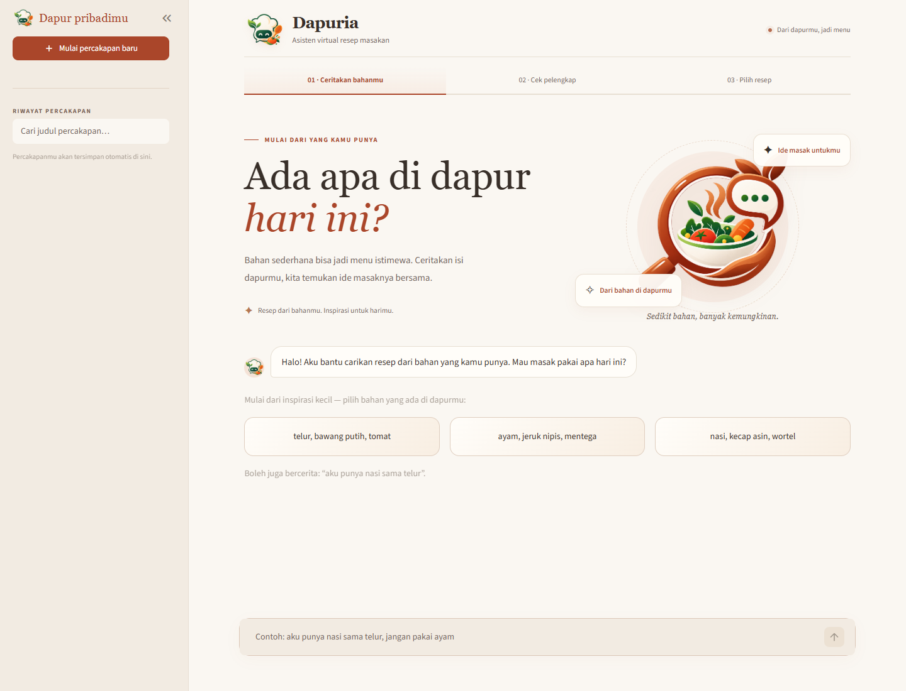

**Gambar 2.1 — Halaman awal Dapuria pada desktop.**  
File: `artifacts/ui/home-desktop.png`. Status: **Tersedia**.

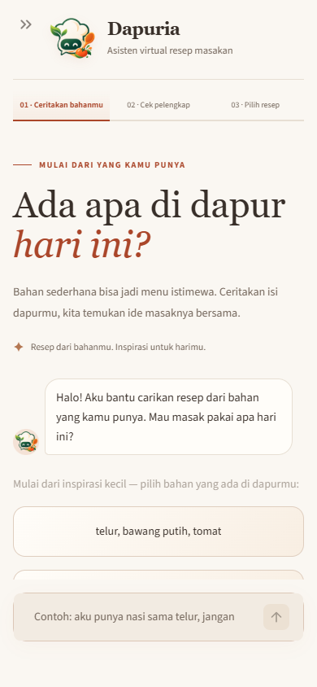

**Gambar 2.2 — Halaman awal Dapuria pada layar ponsel.**  
File: `artifacts/ui/home-mobile.png`. Status: **Tersedia**.

## 2.2 Memulai Pencarian Resep

1. Klik kolom masukan di bawah halaman.
2. Tulis bahan yang benar-benar tersedia.
3. Tekan **Enter** atau ikon panah kirim.
4. Tunggu balasan aplikasi. Klik contoh bahan jika ingin langsung mencoba masukan yang disediakan.

Masukan dapat berupa daftar atau kalimat sederhana:

```text
nasi, telur, bawang putih
aku punya nasi sama telur
di kulkas ada tahu dan bawang putih
aku punya 2 butir telur sama 100 gr dada ayam
```

Gunakan nama bahan yang jelas. Nama majemuk seperti `bawang putih`, `kecap manis`, dan `dada ayam` dapat ditulis utuh. Alias `telor` dikenali sebagai `telur`, `baput/bawput` sebagai `bawang putih`, dan `bamer` sebagai `bawang merah`. Masukan `dada ayam 250 gr` dibaca sebagai `dada ayam`; bawang merah tetap dibedakan dari bawang bombay.

Sertakan minimal satu bahan utama yang dikenali, misalnya nasi, telur, ayam, tahu, tempe, kentang, atau sayuran. Masukan yang hanya berisi bumbu dapat meminta penambahan bahan utama.

## 2.3 Menunggu Pemrosesan

Selama pencarian berlangsung, kolom masukan, tombol kirim, jawaban cepat, dan navigasi percakapan dinonaktifkan. Tunggu sampai aplikasi selesai; tidak perlu menekan Enter berulang kali.

Pencarian pertama dapat lebih lama karena model baru dimuat atau diunduh. Jika muncul pesan kegagalan, ikuti petunjuk pada bagian 2.12.

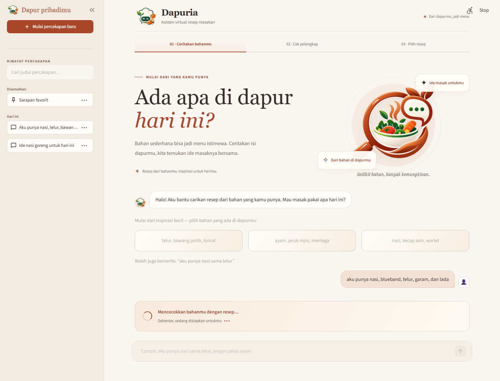

**Gambar 2.3 — Input dinonaktifkan selama pemrosesan.**  
File: `artifacts/ui/direct-loading-desktop.png`. Status: **Tersedia**.  
Alternatif ponsel: `artifacts/ui/direct-loading-mobile.png`.

## 2.4 Menjawab Pertanyaan Bahan Pelengkap

Pada pencarian tertentu, aplikasi menanyakan satu bahan pelengkap. Pertanyaan ini tidak selalu muncul.

Contoh pertanyaan:

> Ada kaldu juga? Kalau nggak ada, kita lanjut pakai bahan yang kamu punya.

Jawab melalui tombol atau kolom masukan:

| Kondisi | Jawaban |
| --- | --- |
| Bahan tersedia | **Ada, tambahkan**, `ada`, atau `iya` |
| Bahan tidak tersedia | **Tidak ada, lanjut saja** atau `tidak ada` |
| Hanya memiliki jenis tertentu | `adanya kaldu jamur` |
| Bahan yang ditanyakan tersedia, sekaligus ingin menyebut bahan lain | `ada, aku juga ada garam sama lada` |
| Bahan yang ditanyakan tidak ada, tetapi ada bahan lain | `tidak ada bawang putih, tapi aku punya garam sama lada` |

Jawaban `ada` atau `iya` berlaku untuk satu bahan yang sedang ditanyakan. Jika pertanyaan menyebut `kaldu`, jawaban `adanya kaldu jamur` menyimpan `kaldu jamur` sebagai bahan yang dimiliki.

Jawaban ragu seperti `mungkin ada` atau pertanyaan seperti `garam apa?` belum dianggap sebagai konfirmasi. Jawab kembali dengan jelas atau gunakan tombol yang tersedia.

Jika hanya menyebut tambahan bahan tanpa menjawab bahan yang ditanyakan, aplikasi dapat tetap menunggu konfirmasi. Tambahan bahan yang dikenali akan dipakai setelah klarifikasi diselesaikan.

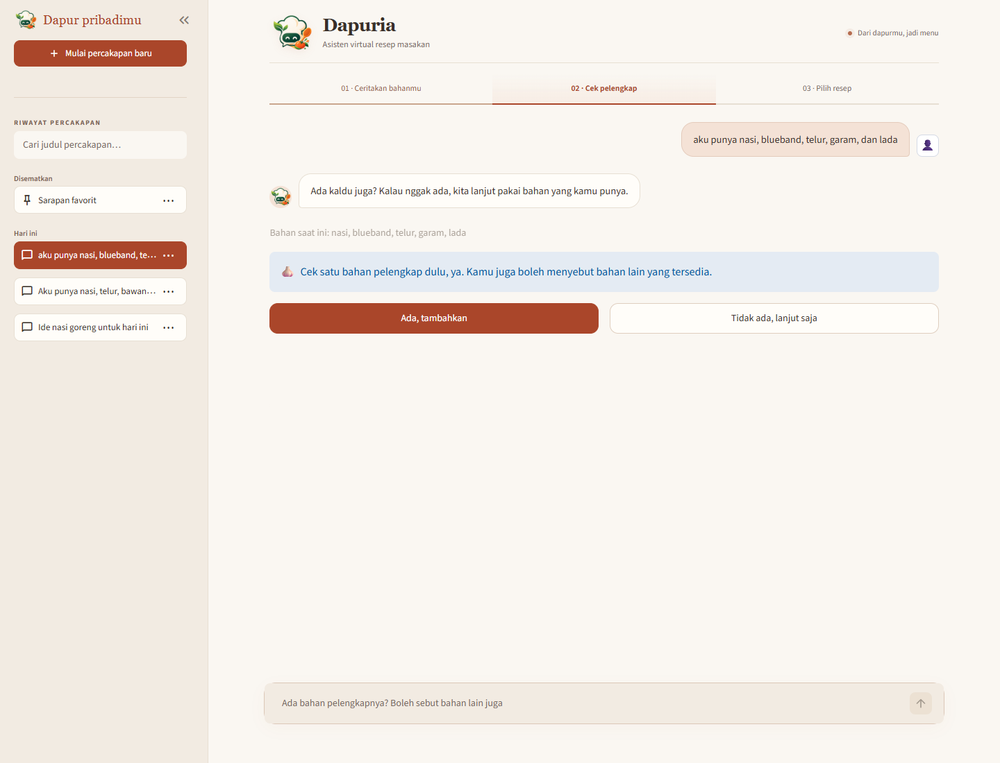

**Gambar 2.4 — Pertanyaan tentang bahan pelengkap.**  
File: `artifacts/ui/clarification-question-desktop.png`. Status: **Tersedia**.

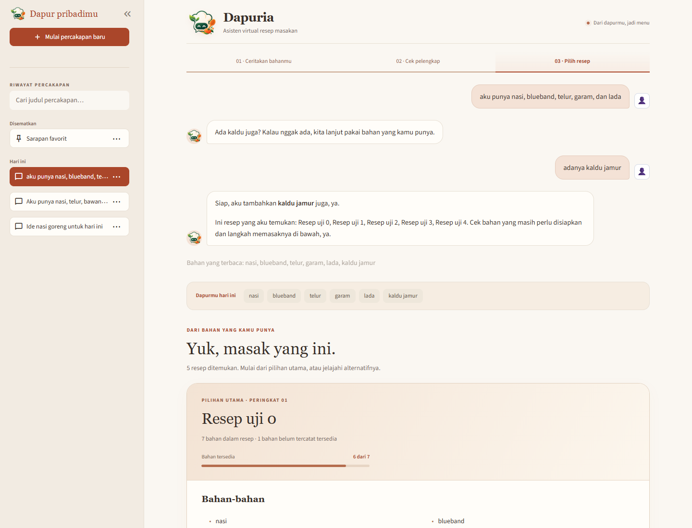

**Gambar 2.5 — Jenis kaldu yang disebutkan pengguna masuk ke bahan pencarian.**  
File: `artifacts/ui/clarification-variant-desktop.png`. Status: **Tersedia**.

## 2.5 Membaca Hasil Rekomendasi

Setelah pencarian selesai, aplikasi menampilkan maksimal lima resep. Jumlahnya dapat lebih sedikit jika hanya sebagian kandidat memenuhi aturan.

Pada mode aplikasi bawaan, resep yang membutuhkan lebih sedikit bahan tambahan diprioritaskan dari kandidat yang relevan. Alternatif dipilih dari keluarga judul berbeda, sehingga beberapa varian ayam kecap tidak mengisi seluruh daftar. Jumlah hasil juga dapat berkurang jika variasi yang memenuhi syarat terbatas.

| Informasi | Cara membaca |
| --- | --- |
| **Bahan yang terbaca / Dapurmu hari ini** | Daftar bahan yang digunakan pada pencarian tersebut |
| **Pilihan utama · Peringkat 01** | Resep pada urutan pertama hasil sistem |
| **Bahan tersedia**, misalnya `4 dari 7` | Jumlah bahan resep yang cocok dengan bahan pengguna, bukan persentase kualitas rekomendasi |
| **Bahan-bahan** | Daftar bahan resep |
| **Bahan yang kamu punya** | Bahan resep yang terhitung tersedia |
| **Yang perlu disiapkan** | Bahan resep yang belum terhitung tersedia |
| **Resep lainnya** | Alternatif pada peringkat berikutnya |

Rekomendasi dapat memerlukan bahan tambahan. Periksa daftar **Yang perlu disiapkan** sebelum memilih resep.


**Gambar 2.6 — Tampilan resep utama dan alternatif.**  
File: `artifacts/ui/results-desktop.png`. Status: **Tersedia**.  
Alternatif ponsel: `artifacts/ui/results-mobile.png`.

## 2.6 Membuka Detail dan Membaca Langkah Memasak

Resep utama langsung menampilkan bahan dan langkah memasak. Untuk resep alternatif:

1. Cari resep pada bagian **Resep lainnya**.
2. Klik **Lihat detail**.
3. Baca bahan, bahan yang belum tersedia, dan langkah memasak pada dialog.
4. Klik **Kembali ke rekomendasi** atau tombol tutup untuk kembali ke daftar.

Langkah memasak ditampilkan sebagai daftar bernomor. Setiap nomor menandai langkah yang dipisahkan dari teks sumber. Angka takaran seperti `1.5 sdm` tidak digunakan sebagai nomor langkah.

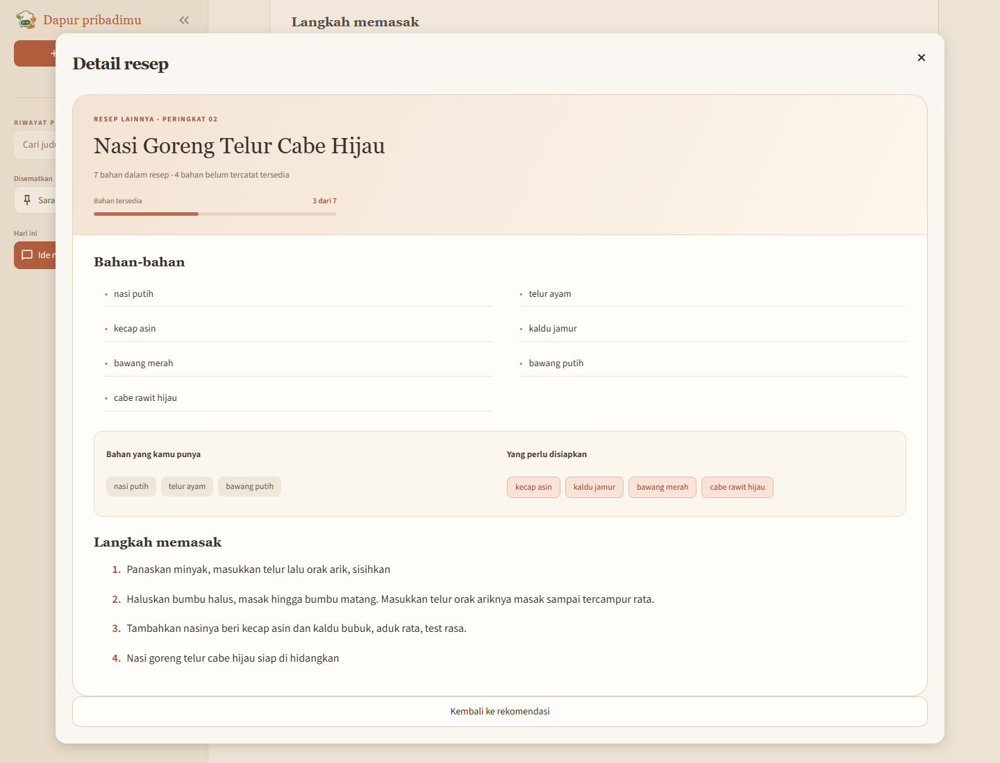

**Gambar 2.7 — Dialog detail resep alternatif.**  
File: `artifacts/ui/recipe-detail-desktop.png`. Status: **Tersedia**.  
Alternatif ponsel: `artifacts/ui/recipe-detail-mobile.png`.

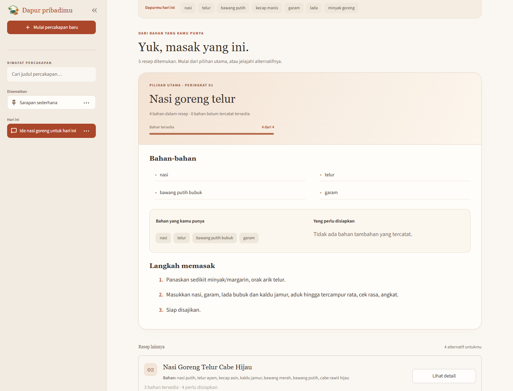

**Gambar 2.8 — Langkah memasak dalam daftar bernomor.**  
File: `artifacts/ui/cooking-steps-desktop.png`. Status: **Tersedia**.  
Alternatif ponsel: `artifacts/ui/cooking-steps-mobile.png`.

## 2.7 Melanjutkan Percakapan atau Mencari Resep Baru

Setelah hasil akhir tampil, kolom masukan diganti dengan dua pilihan. Geser ke bawah sampai melewati seluruh alternatif resep dan teks petunjuk.

| Tombol | Hasil |
| --- | --- |
| **Lanjutkan percakapan** | Membuka kembali kolom masukan pada chat yang sama; bahan dan batasan sebelumnya dipertahankan |
| **Cari resep baru** | Membuka percakapan kosong dengan bahan dan batasan baru; percakapan lama tetap ada di riwayat |
| **Mulai percakapan baru** di sidebar | Membuka percakapan kosong dari sidebar |

Pilih **Lanjutkan percakapan** jika ingin menambahkan atau mengubah bahan. Pilih **Cari resep baru** jika ingin memulai pencarian yang terpisah.

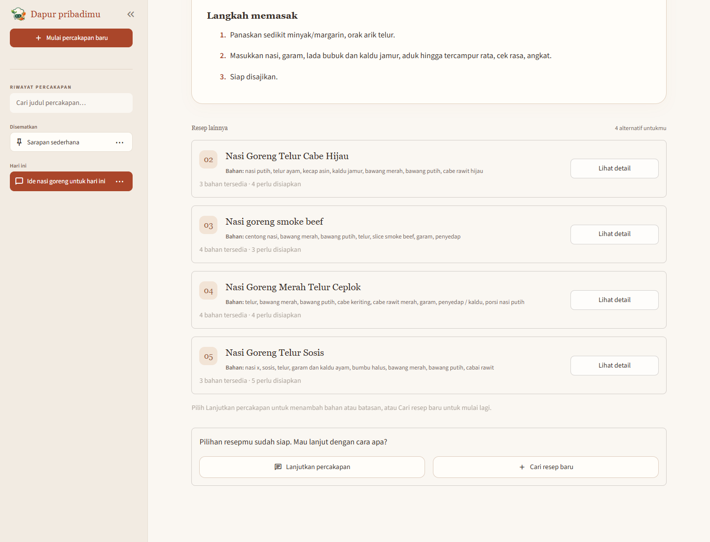

**Gambar 2.9 — Tombol lanjut dan pencarian baru di bawah hasil resep.**  
File: `artifacts/ui/results-bottom-actions-desktop.png`. Status: **Tersedia**.  
Alternatif ponsel: `artifacts/ui/results-bottom-actions-mobile.png`.

## 2.8 Memperbarui Bahan dalam Percakapan

Jika hasil akhir sudah tampil, klik **Lanjutkan percakapan** sebelum mengetik perubahan.

| Tujuan | Contoh masukan | Perubahan yang diharapkan |
| --- | --- | --- |
| Menambah bahan | `aku juga punya wortel` | Wortel ditambahkan; bahan sebelumnya dipertahankan |
| Menghapus bahan yang habis | `telurnya ternyata habis` | Telur dihapus dari persediaan percakapan |
| Mengganti bahan | `ganti nasi dengan kentang` | Nasi diganti dengan kentang |
| Mengosongkan konteks dalam chat yang sama | `mulai dari awal` | Daftar bahan dan batasan dikosongkan; aplikasi meminta bahan kembali |
| Reset sekaligus menyebut bahan baru | `mulai dari awal, aku punya tahu dan bawang putih` | Pencarian menggunakan bahan baru yang disebutkan |

Perubahan bahan dapat memicu pencarian ulang dan pertanyaan pelengkap. Periksa informasi bahan yang terbaca setelah perubahan diproses.

## 2.9 Mengatur Bahan yang Dihindari

Sebutkan batasan secara eksplisit pada pencarian awal atau setelah menekan **Lanjutkan percakapan**.

```text
aku punya nasi sama telur, jangan pakai ayam
hindari udang
tanpa bawang putih
```

| Perintah | Fungsi |
| --- | --- |
| `jangan pakai ayam` | Menyisihkan resep yang nama bahannya menyebut ayam |
| `boleh pakai ayam` | Melepas batasan ayam |
| `hapus batasan ayam` | Melepas satu batasan |
| `hapus batasan` | Melepas seluruh batasan pada percakapan tersebut |

Batasan berlaku pada chat yang sama sampai dilepas atau konteks direset. **Cari resep baru** memulai chat tanpa batasan lama.

**Bedakan ketersediaan dan larangan:** `ayam habis` menghapus ayam dari persediaan, sedangkan `jangan pakai ayam` menyaring resep yang mengandung nama bahan ayam.

Filter memakai nama bahan yang tercatat pada resep. Contohnya, larangan `ayam` juga menyaring `kaldu ayam`, tetapi tidak menyaring `bayam`. Periksa sendiri komposisi bahan kemasan atau turunan yang tidak disebutkan dalam daftar resep.

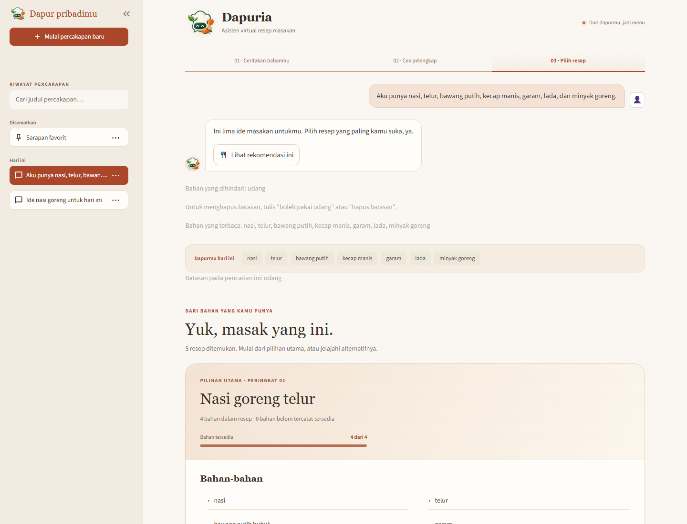

**Gambar 2.10 — Percakapan dengan batasan bahan.**  
File: `artifacts/ui/filtered-results-desktop.png`. Status: **Tersedia**.  
Alternatif ponsel: `artifacts/ui/filtered-results-mobile.png`.

## 2.10 Mengelola Riwayat Percakapan

### 2.10.1 Membuka percakapan

1. Buka sidebar **Dapur pribadimu**.
2. Cari judul pada daftar riwayat.
3. Klik judul untuk memuat pesan dan hasil tersimpan.

Riwayat disimpan otomatis secara lokal. Membuka riwayat tidak menjalankan pencarian ulang. Percakapan yang belum selesai pada tahap klarifikasi dapat dilanjutkan setelah dibuka kembali.

Percakapan yang dipin berada pada kelompok **Disematkan**. Riwayat lain dikelompokkan berdasarkan waktu, misalnya **Hari ini**, **Kemarin**, atau tanggal. Gunakan scroll vertikal jika jumlah chat banyak.

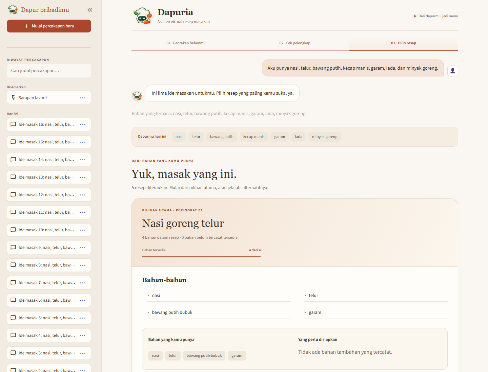

**Gambar 2.11 — Daftar riwayat dan percakapan yang disematkan.**  
File: `artifacts/ui/history-no-horizontal-scroll-desktop.png`. Status: **Tersedia**.  
Alternatif ponsel: `artifacts/ui/history-no-horizontal-scroll-mobile.png`.

### 2.10.2 Mencari judul

1. Ketik sebagian judul pada kolom **Cari judul percakapan…**.
2. Pilih judul yang sesuai dari hasil penyaringan.
3. Kosongkan kolom untuk menampilkan seluruh riwayat kembali.

Pencarian mencocokkan judul percakapan, bukan isi seluruh pesan. Judul yang dipin tetap dapat dicari.

**Gambar 2.12 — Pencarian judul percakapan.**  
Status: **Perlu screenshot manual.**  
Nama file yang disarankan: `artifacts/ui/manual/user-history-search.png`.  
Ambil sidebar setelah kata kunci diketik dan daftar riwayat tersaring.

### 2.10.3 Pin dan lepas pin

1. Klik **⋯** pada baris chat yang ingin dikelola.
2. Pilih **Pin chat** untuk menempatkannya pada kelompok **Disematkan**.
3. Jika sudah dipin, pilih **Lepas pin** untuk mengembalikannya ke urutan riwayat biasa.

Pengaturan ini dapat dilakukan tanpa membuka chat tersebut.

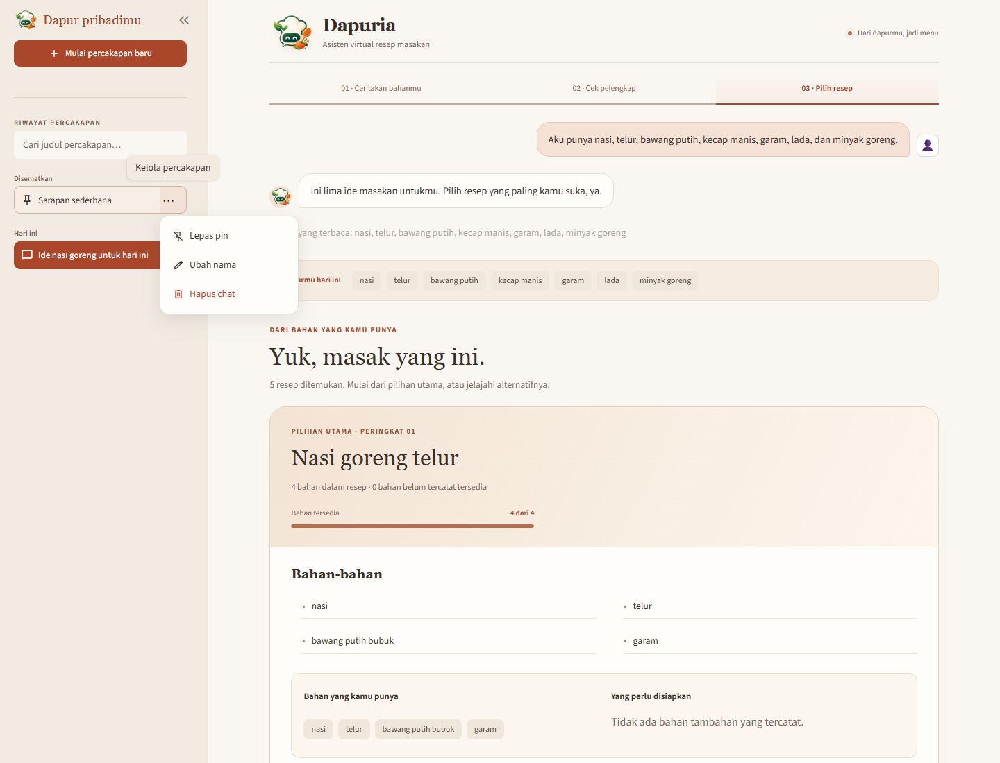

**Gambar 2.13 — Menu pengelolaan riwayat percakapan.**  
File: `artifacts/ui/history-menu-desktop.png`. Status: **Tersedia**.  
Alternatif ponsel: `artifacts/ui/history-menu-mobile.png`.

### 2.10.4 Mengubah nama chat

1. Klik **⋯** pada chat yang dituju.
2. Pilih **Ubah nama**.
3. Ganti isi kolom **Judul percakapan**.
4. Tekan **Enter** atau klik **Simpan judul**.

Judul tidak boleh kosong dan dibatasi maksimal 72 karakter. Klik **Batal** atau tombol tutup untuk menutup dialog tanpa menyimpan.

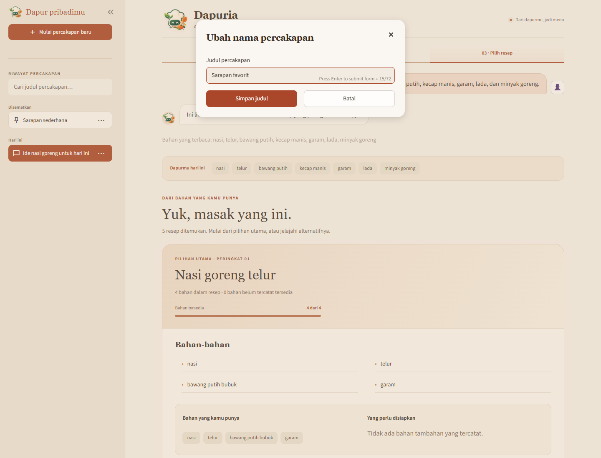

**Gambar 2.14 — Dialog untuk mengubah nama percakapan.**  
File: `artifacts/ui/history-rename-desktop.png`. Status: **Tersedia**.  
Alternatif ponsel: `artifacts/ui/history-rename-mobile.png`.

### 2.10.5 Menghapus chat

1. Periksa judul chat yang akan dihapus.
2. Klik **⋯** pada baris tersebut.
3. Pilih **Hapus chat**.

Penghapusan langsung berlaku tanpa dialog konfirmasi tambahan. Pesan dan hasil tersimpan pada chat tersebut ikut dihapus. Tidak ada tombol undo pada aplikasi; pemulihan memerlukan cadangan dari developer.

Jika chat yang sedang dibuka dihapus, aplikasi kembali ke percakapan kosong. Menghapus chat lain tidak menghapus percakapan yang sedang aktif.

## 2.11 Melihat Hasil Pencarian Sebelumnya

Pada chat yang mempunyai beberapa pencarian, hasil lama dapat ditampilkan kembali:

1. Cari balasan lama yang memiliki tombol **Lihat rekomendasi ini**.
2. Klik tombol tersebut jika tersedia.
3. Aplikasi memberi keterangan bahwa yang sedang ditampilkan adalah rekomendasi sebelumnya.
4. Klik **Kembali ke hasil terbaru** untuk menutup tampilan hasil lama.

Resep dan bahan pada hasil lama mengikuti keadaan saat pencarian tersebut dilakukan; perubahan bahan atau batasan saat ini tidak menulis ulang hasil tersimpan.

**Gambar 2.15 — Membuka rekomendasi sebelumnya dalam satu chat.**  
Status: **Perlu screenshot manual.**  
Nama file yang disarankan: `artifacts/ui/manual/user-previous-recommendations.png`.  
Siapkan chat dengan minimal dua hasil pencarian berbeda, buka hasil lama, lalu ambil keterangan hasil sebelumnya dan tombol kembali ke hasil terbaru.

## 2.12 Menangani Kendala Penggunaan

| Kondisi | Tindakan pengguna |
| --- | --- |
| Tidak ada bahan yang terbaca | Tulis daftar sederhana, misalnya `nasi, telur, bawang putih` |
| Diminta menambahkan bahan utama | Tambahkan bahan seperti telur, tahu, ayam, nasi, kentang, atau sayuran |
| Pertanyaan pelengkap belum selesai | Jawab bahan yang ditanyakan dengan jelas atau klik jawaban cepat |
| Tidak ditemukan resep yang memenuhi syarat | Tambahkan bahan yang tersedia, ubah kombinasi, atau lepas batasan yang memang tidak diperlukan |
| Input tidak bisa diketik | Jika indikator proses aktif, tunggu; jika hasil sudah selesai, klik **Lanjutkan percakapan** |
| Hasil memerlukan bahan yang belum dimiliki | Periksa **Yang perlu disiapkan** dan pertimbangkan alternatif lain |
| Bahan terbaca kurang tepat | Gunakan **Lanjutkan percakapan**, lalu sebut penghapusan/penggantian bahan secara jelas; jika perlu, mulai pencarian baru |
| Pencarian gagal atau tidak selesai | Tunggu pesan kegagalan, coba lagi setelah input aktif; hubungi developer jika berulang |
| Riwayat tidak ditemukan | Kosongkan pencarian judul dan periksa kelompok Disematkan; pastikan menggunakan server penyimpanan yang sama |
| Muncul peringatan riwayat belum tersimpan | Jangan menganggap chat sudah tersimpan permanen; laporkan kepada developer agar lokasi dan izin database diperiksa |

**Gambar 2.16 — Pesan saat bahan utama belum dikenali.**  
Status: **Perlu screenshot manual.**  
Nama file yang disarankan: `artifacts/ui/manual/user-main-ingredient-required.png`.  
Masukkan bumbu saja, misalnya `garam, gula, kecap manis`, kemudian ambil pesan yang meminta bahan utama.

## 2.13 Contoh Alur Penggunaan

Contoh berikut menjelaskan urutan penggunaan; jenis dan urutan resep yang muncul mengikuti data dan hasil pencarian pada aplikasi.

| Langkah | Tindakan |
| --- | --- |
| 1 | Buka aplikasi dan tulis `aku punya nasi sama telur` |
| 2 | Kirim masukan dan tunggu pemrosesan |
| 3 | Jika ditanya bahan pelengkap, jawab sesuai persediaan; gunakan tombol jika ingin melanjutkan tanpa tambahan |
| 4 | Periksa bahan yang terbaca, resep utama, dan bahan yang perlu disiapkan |
| 5 | Klik **Lihat detail** pada alternatif untuk membandingkan bahan dan langkah |
| 6 | Geser ke bawah dan klik **Lanjutkan percakapan** |
| 7 | Kirim `aku juga punya wortel` untuk memperbarui konteks dan mencari kembali |
| 8 | Buka sidebar, ubah judul menjadi `Ide makan malam`, lalu pin percakapan jika ingin mudah ditemukan |
| 9 | Pilih **Cari resep baru** jika ingin memakai daftar bahan yang berbeda pada chat baru |

## 2.14 Batas Kemampuan Aplikasi

- Masukan diproses menggunakan aturan percakapan umum. Jika kalimat kompleks tidak terbaca tepat, gunakan daftar bahan yang lebih sederhana.
- Alias `telor → telur`, `baput/bawput → bawang putih`, dan `bamer → bawang merah` tersedia. Koreksi typo bebas untuk seluruh nama bahan belum tersedia, dan tidak ada editor koreksi bahan.
- Persediaan menyimpan nama bahan dalam konteks chat. Aplikasi tidak mengelola jumlah stok, ukuran porsi, atau pengurangan bahan setelah memasak.
- Pencocokan membedakan bahan asal dengan produk tertentu: memiliki `ayam` tidak berarti memiliki `kaldu ayam`; memiliki `udang` tidak berarti memiliki `terasi udang`.
- Resep berasal dari corpus, sehingga kelengkapan bahan, takaran, dan langkah mengikuti data sumber. Aplikasi tidak menambahkan takaran yang tidak tercantum.
- Filter bahan mengikuti nama yang tercatat pada resep, bukan pemeriksaan lengkap semua komposisi turunannya.
- Riwayat digunakan bersama oleh browser yang mengakses server lokal yang sama. Belum ada akun pengguna terpisah.
- Fitur favorit resep, daftar belanja, unduh chat, simpan resep, dan panel alasan rekomendasi tidak tersedia pada versi ini. Detail penelitian disembunyikan dari tampilan pengguna.
- Menutup tab browser tidak menghentikan server. Untuk menghentikan program, developer menekan **Ctrl+C** pada terminal server.

## 2.15 Daftar Gambar dan Kebutuhan Screenshot Tambahan

Semua path berikut dihitung dari root project. Untuk gambar yang perlu diambil sendiri, buat folder `artifacts/ui/manual/` terlebih dahulu.

### 2.15.1 Gambar yang sudah tersedia

| Nomor | Nama file | Bagian penggunaan |
| --- | --- | --- |
| 2.1 | `artifacts/ui/home-desktop.png` | Halaman awal desktop |
| 2.2 | `artifacts/ui/home-mobile.png` | Halaman awal ponsel |
| 2.3 | `artifacts/ui/direct-loading-desktop.png` | Pemrosesan dan input terkunci |
| 2.4 | `artifacts/ui/clarification-question-desktop.png` | Pertanyaan bahan pelengkap |
| 2.5 | `artifacts/ui/clarification-variant-desktop.png` | Jawaban jenis kaldu tertentu |
| 2.6 | `artifacts/ui/results-desktop.png` | Hasil rekomendasi |
| 2.7 | `artifacts/ui/recipe-detail-desktop.png` | Dialog detail alternatif |
| 2.8 | `artifacts/ui/cooking-steps-desktop.png` | Langkah memasak bernomor |
| 2.9 | `artifacts/ui/results-bottom-actions-desktop.png` | Tombol lanjut/chat baru |
| 2.10 | `artifacts/ui/filtered-results-desktop.png` | Batasan bahan |
| 2.11 | `artifacts/ui/history-no-horizontal-scroll-desktop.png` | Daftar riwayat |
| 2.13 | `artifacts/ui/history-menu-desktop.png` | Menu pin, rename, dan hapus |
| 2.14 | `artifacts/ui/history-rename-desktop.png` | Dialog ubah nama |

Versi ponsel untuk sebagian besar tampilan tersedia dengan mengganti akhiran `desktop` menjadi `mobile`. Pilih salah satu versi sesuai kebutuhan halaman Word; tidak perlu memasukkan keduanya untuk setiap langkah.

### 2.15.2 Gambar yang perlu diambil sendiri

| Nomor | Nama file yang disarankan | Objek screenshot |
| --- | --- | --- |
| 1.1 | `artifacts/ui/manual/developer-project-structure.png` | Struktur project pada Explorer VS Code |
| 1.2 | `artifacts/ui/manual/developer-python-installation.png` | Installer Python atau hasil pemeriksaan versi |
| 1.3 | `artifacts/ui/manual/developer-dependencies-ready.png` | Pemeriksaan environment dan dependensi berhasil |
| 1.4 | `artifacts/ui/manual/developer-ollama-ready.png` | Model `llama3` pada `ollama list`; opsional |
| 1.5 | `artifacts/ui/manual/developer-streamlit-running.png` | Terminal server dan Local URL |
| 1.6 | `artifacts/ui/manual/developer-smoke-test.png` | Healthcheck dan pencarian dengan model/indeks sebenarnya |
| 2.12 | `artifacts/ui/manual/user-history-search.png` | Sidebar dengan pencarian judul yang sudah tersaring |
| 2.15 | `artifacts/ui/manual/user-previous-recommendations.png` | Tampilan rekomendasi sebelumnya dalam satu chat |
| 2.16 | `artifacts/ui/manual/user-main-ingredient-required.png` | Pesan yang meminta penambahan bahan utama |

Nama file di atas merupakan penanda kebutuhan gambar, bukan file yang sudah dibuat. Setelah screenshot tersedia, sisipkan pada bagian dan nomor gambar yang sesuai.
